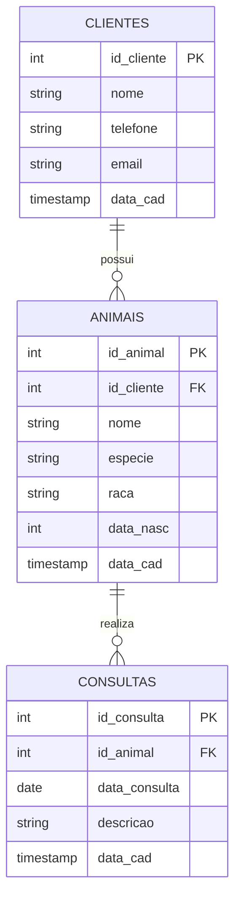

# Documentação do Banco de Dados - Clínica Veterinária

## 1. Diagrama Entidade-Relacionamento (DER)

---

## 2. Dicionário de Dados

### Tabela: clientes
| Campo | Tipo | Nulo | Chave | Padrão | Descrição |
|---|---|---|---|---|---|
| `id_cliente` | INT | Não | PK | Auto | Identificador único do cliente |
| `nome` | VARCHAR(100) | Não | - | - | Nome completo do cliente |
| `telefone` | VARCHAR(15) | Não | - | - | Telefone de contato |
| `email` | VARCHAR(150) | Sim | - | NULL | E-mail do cliente |
| `data_cad` | TIMESTAMP | Não | - | CURRENT_TIMESTAMP | Data/hora do cadastro |

### Tabela: animais
| Campo | Tipo | Nulo | Chave | Padrão | Descrição |
|---|---|---|---|---|---|
| `id_animal` | INT | Não | PK | Auto | Identificador único do animal |
| `id_cliente` | INT | Não | FK | - | Código do dono (referência `clientes`) |
| `nome` | VARCHAR(50) | Não | - | - | Nome do animal |
| `especie` | VARCHAR(20) | Não | - | - | Espécie (ex: Cão, Gato) |
| `raca` | VARCHAR(30) | Sim | - | NULL | Raça do animal |
| `data_nasc` | YEAR | Sim | - | NULL | Ano de nascimento |
| `data_cad` | TIMESTAMP | Não | - | CURRENT_TIMESTAMP | Data/hora do cadastro |

### Tabela: consultas
| Campo | Tipo | Nulo | Chave | Padrão | Descrição |
|---|---|---|---|---|---|
| `id_consulta` | INT | Não | PK | Auto | Identificador único da consulta |
| `id_animal` | INT | Não | FK | - | Código do animal (referência `animais`) |
| `data_consulta` | DATE | Não | - | - | Data agendada para a consulta |
| `descricao` | VARCHAR(250) | Não | - | - | Motivo da consulta |
| `data_cad` | TIMESTAMP | Não | - | CURRENT_TIMESTAMP | Data/hora do agendamento |